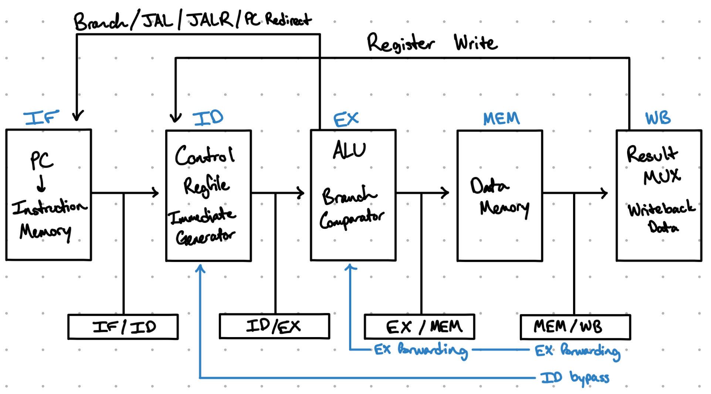

## Architecture

The final CPU uses a five-stage pipelined architecture consisting of Instruction Fetch (IF), Instruction Decode (ID), Execute (EX), Memory (MEM), and Writeback (WB). Pipeline registers separate each stage so that multiple instructions can be processed at the same time.

The processor includes data forwarding, load-use hazard detection, pipeline stalls and bubbles, WB-to-ID register bypassing, and control-hazard flushing for branches and jumps.



A more detailed explanation of the processor architecture can be found in [docs/architecture.md](docs/architecture.md).

## Supported Instructions

The processor supports the following RV32I instructions:

- Arithmetic and logical: `ADD`, `SUB`, `AND`, `OR`, `XOR`, `SLL`, `SRL`, `SRA`, `SLT`, `SLTU`
- Immediate arithmetic and logical: `ADDI`, `ANDI`, `ORI`, `XORI`, `SLLI`, `SRLI`, `SRAI`, `SLTI`, `SLTIU`
- Loads: `LB`, `LBU`, `LH`, `LHU`, `LW`
- Stores: `SB`, `SH`, `SW`
- Branches: `BEQ`, `BNE`, `BLT`, `BGE`, `BLTU`, `BGEU`
- Jumps: `JAL`, `JALR`
- Upper immediate: `LUI`, `AUIPC`

## Verification

The processor was verified using self-checking SystemVerilog testbenches. Individual components were tested independently before being integrated into the single-cycle CPU and later the five-stage pipelined CPU.

Pipeline testing included data forwarding, load-use hazards, pipeline stalls and bubbles, WB-to-ID register bypassing, branch handling, JAL/JALR control flow, instruction flushing, mixed instruction stress tests, and RV32I regression testing.

The final pipelined processor passed **81/81 verification checks**.

A more detailed explanation of the verification process can be found in [docs/verification.md](docs/verification.md).

## FPGA Implementation

The five-stage pipelined CPU was synthesized and implemented using Vivado 2024.2 targeting a Xilinx Artix-7 FPGA.

Post-route results:

- Target FPGA: Xilinx Artix-7 XC7A35T
- Clock period: 5.5 ns
- Maximum validated frequency: **181.8 MHz**
- Slice LUTs: **290**
- Slice registers: **226**
- Slices: **112**
- LUTs used as memory: **44**

The processor successfully met setup and hold timing requirements at the 5.5 ns clock period.

## Repository Structure

```text
rv32i-cpu/
|-- rtl/
|   |-- pipeline/
|      |-- SystemVerilog CPU modules
|-- tb/
|   |-- Self-checking SystemVerilog testbenches
|-- programs/
|   |-- Test programs and memory initialization files
|-- constraints/
|   |-- FPGA timing constraints
|-- docs/
|   |-- images/
|   |   |-- pipeline_diagram.jpg
|   |-- architecture.md
|   |-- verification.md
|-- README.md
```

## Running Simulations

The processor was simulated using Icarus Verilog with SystemVerilog support.

SystemVerilog files can be compiled using:

```bash
iverilog -g2012 -o build/test <RTL files> <testbench>
```

The compiled simulation can then be run using:

```bash
vvp build/test
```

The self-checking testbenches automatically compare processor outputs against expected results and report the number of passed and failed checks.