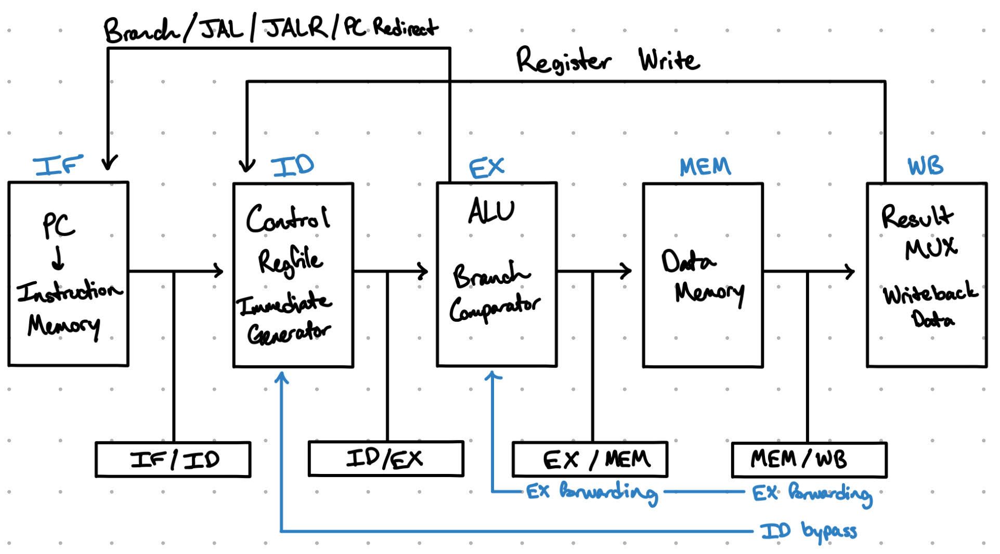

# Architecture

## Single-Cycle CPU

The single-cycle CPU architecture is able to complete the instruction fetch, instruction decode, execute, memory access, and writeback in one clock cycle. The single-cycle CPU design was able to help me in fundamentally understanding how to implement the design of each of the five steps in SystemVerilog, and also being able to verify the datapath and control logic before pipelining.

## Five-Stage Pipeline

The CPU design was then divided into the IF, ID, EX, MEM, and WB so that multiple instructions could be in different stages at the same time, which is the main objective of instruction pipelining.

### Instruction Fetch (IF)

The program counter (PC) selects the instruction address, instruction memory outputs the instruction, and we then increment PC + 4.

### Instruction Decode (ID)

Once the instruction is clearly fetched, we decode the opcode/control signals, read the 2 source registers, generate any immediates, and prepare the values for execution.

### Execute (EX)

The ALU unit processes the values from the instruction decode stage and performs the required arithmetic or logical operations. Additionally, the branch comparator, branch target generation, JAL/JALR target logic, and data forwarding are also handled in this stage.

### Memory (MEM)

If load or store instructions are processed, they would enter the memory stage in order to access data memory.

### Write Back (WB)

Once everything has executed, the writeback stage will select either the ALU result, memory data, or the incremented program counter to write back to the destination register.

## Pipeline Registers

The pipeline utilizes four pipeline registers: IF/ID, ID/EX, EX/MEM, and MEM/WB. The IF/ID pipeline register stores the fetched instruction and program counter information so that the decode stage can use them. The ID/EX pipeline register stores decoded source register values, immediates, register numbers, and control signals needed for the execution stage. The EX/MEM pipeline register stores the ALU result, store data, destination register, and control signals needed for the memory stage. Finally, the MEM/WB pipeline register stores the results and control information needed for the writeback stage.

## Data Forwarding

Because some instructions might rely on results from recent previous instructions, we needed a data forwarding unit in order to quickly get execution results to the instruction requesting the result. Both the EX/MEM and MEM/WB pipeline registers can provide forwarded results. The EX/MEM pipeline register has priority in the forwarding unit because it contains the most recent result when both stages match the requested source register.

## Load-Use Hazard Detection

Sometimes, the load result is not available soon enough for the next instruction, and in that case, a load-use data hazard can occur. To compensate, the PC and IF/ID pipeline register are held, and a bubble is inserted into the ID/EX pipeline register to prevent the dependent instruction from entering the execution stage before the load result is available.

## WB-to-ID Register Bypassing

In same-cycle cases, WB writes to a register that ID is also trying to read. In order to resolve this issue, I created a register bypass that lets the ID read the same register without needing to wait for WB to update the register file first.

## Control Hazards

Control hazards can occur when branch, JAL, or JALR instructions change the program counter from the normal PC + 4 sequence. Since these control-flow instructions are resolved in the execution stage, instructions from the incorrect path may have already entered the pipeline. When a control redirect occurs, the PC is changed to the correct branch or jump target, and the incorrect instructions in the earlier pipeline stages are flushed.

## Pipeline Stalls, Bubbles, and Flushes

Pipeline stalls temporarily hold an instruction in place. In this design, stalls are used when a load-use data hazard occurs. Pipeline bubbles are empty operations inserted into the pipeline during a stall so that the dependent instruction does not enter the execution stage before the load result is available. Pipeline flushes clear instructions that were incorrectly fetched after a control hazard. The CPU continues fetching PC + 4 until the branch or jump is resolved, and once it is resolved in the EX stage, the PC is redirected and the younger incorrect instructions are flushed.